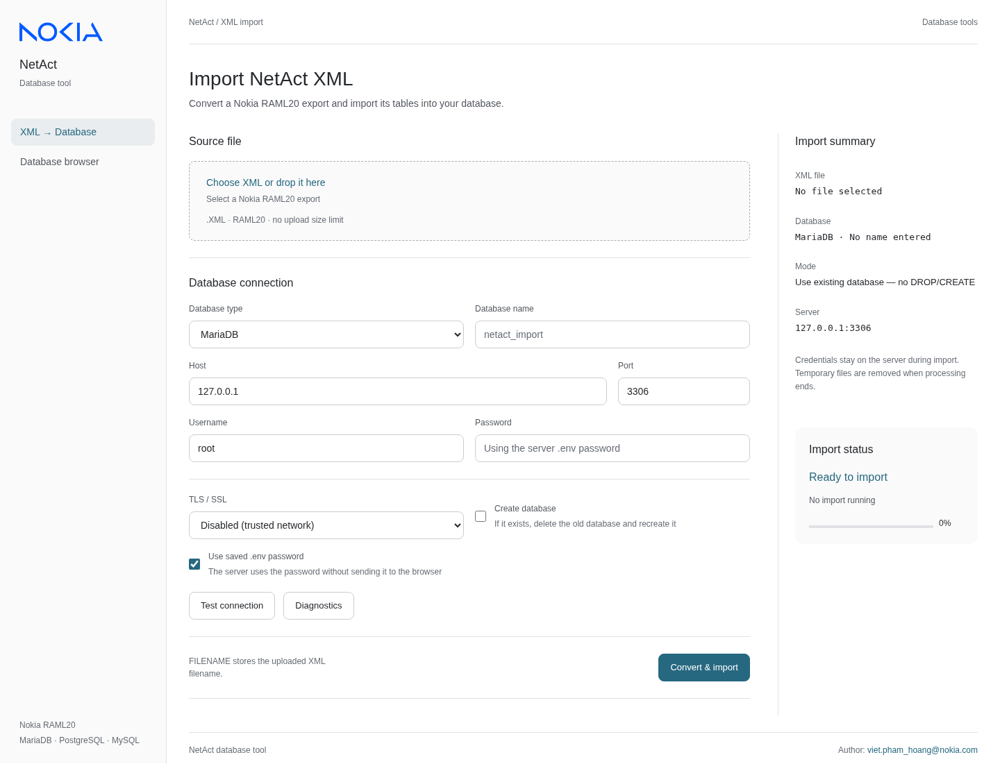
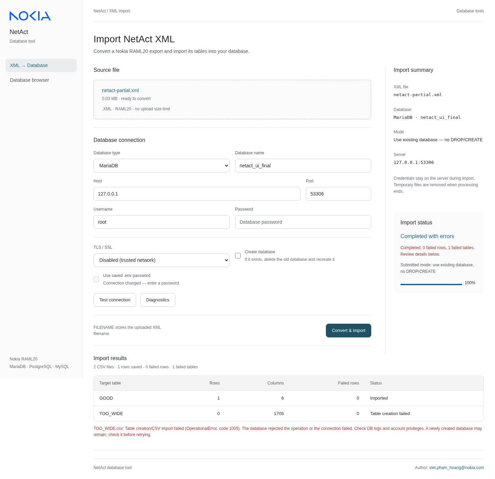
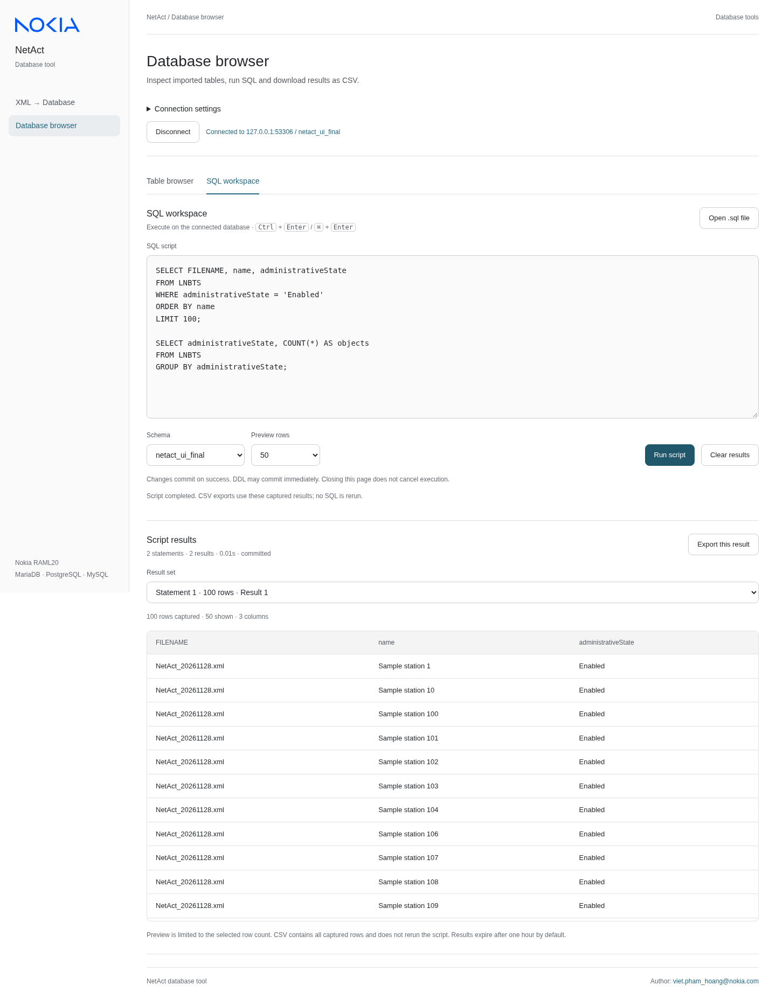

# NetAct Database Tool

Author: [viet.pham_hoang@nokia.com](mailto:viet.pham_hoang@nokia.com)

A local web workspace for **Nokia RAML20 XML → CSV → database**, table browsing, SQL execution and CSV exports.
The interface and runtime messages are in English. Accent color: `#266880`.

[Tiếng Việt](README_VI.md) · [Audit and validation](AUDIT.md)

## Interface preview



The interface uses compact navigation, grouped forms and collapsible connection settings. It includes XML import, table browsing and a SQL workspace. Screenshots below use local sample data.

Design method: [Unslop by Damir Sokolovsky](https://github.com/heydamir/unslop), CC BY 4.0. See the [redesign review and checks](docs/ui-redesign.md).

[Mobile import view](docs/interface-mobile.png) · [Mobile table browser](docs/database-explorer-mobile.png) · [Mobile SQL workspace](docs/sql-workspace-mobile.png)

## Requirements

- Python 3.11+ (Python 3.12 x64 recommended on Windows).
- Java 11+ for XML conversion; Java is not needed for browsing or SQL execution.
- MariaDB, MySQL or PostgreSQL reachable **from the web server**.
- One application worker. Each process has its own import queue and temporary SQL results.

MariaDB uses **MariaDB Connector/Python (`mariadb`)**, matching the original importer.
MySQL uses PyMySQL; PostgreSQL uses psycopg. The uploaded Boda parser JAR is included in `vendor/`.

## Run on Windows (PowerShell)

```powershell
git clone https://github.com/phamhviet/netact-db-tool.git
cd netact-db-tool
py -m venv .venv
.\.venv\Scripts\python.exe -m pip install -r requirements.txt
if (!(Test-Path .env)) { Copy-Item .env.example .env }
notepad .env
.\.venv\Scripts\python.exe -m uvicorn app.main:app --host 127.0.0.1 --port 8000 --workers 1
```

Open **http://localhost:8000** on the same computer. No virtualenv activation or PowerShell execution-policy change is required.
Python 3.12 Windows x64 has a MariaDB wheel. If pip must build the connector, install a compatible MariaDB Connector/C and Visual C++ build tools.

## Run on Linux / macOS

On Debian/Ubuntu, install Java and native MariaDB build dependencies:

```bash
sudo apt-get update
sudo apt-get install -y default-jre-headless gcc python3-dev libmariadb-dev
```

On macOS, install Java and `mariadb-connector-c` with your package manager and enable Xcode Command Line Tools.
Then:

```bash
git clone https://github.com/phamhviet/netact-db-tool.git
cd netact-db-tool
python3 -m venv .venv
.venv/bin/python -m pip install -r requirements.txt
[ -f .env ] || cp .env.example .env
.venv/bin/python -m uvicorn app.main:app --host 127.0.0.1 --port 8000 --workers 1
```

For the exact tested Python dependency set, install `requirements.lock` instead; it also includes test dependencies.
Stop with Ctrl+C after active operations finish. Do not use `--reload` while importing or executing SQL.

## Docker

```bash
docker compose up --build -d
```

The compose file binds `127.0.0.1:8000`, runs a non-root application user, and optionally injects `.env` (Compose 2.24+).
For a database on the Docker host, use `host.docker.internal`, not `localhost` inside the container.
After editing `.env`, recreate the container:

```bash
docker compose up -d --force-recreate
```

Stop with `docker compose down`. A Cloud-local loopback address is not a public preview URL.

## Saved connections: `.env`

Copy `.env.example` to `.env` once. Never overwrite an existing `.env` when updating.
Each engine has its own settings:

```dotenv
MARIADB_HOST=192.168.1.10
MARIADB_PORT=3306
MARIADB_USER=your_user
MARIADB_PASSWORD='your_password'
MARIADB_DATABASE=
MARIADB_SSL_MODE=disable

POSTGRES_HOST=192.168.1.20
POSTGRES_PORT=5432
POSTGRES_USER=your_user
POSTGRES_PASSWORD='your_password'
POSTGRES_DATABASE=
POSTGRES_SSL_MODE=disable

MYSQL_HOST=192.168.1.30
MYSQL_PORT=3306
MYSQL_USER=your_user
MYSQL_PASSWORD='your_password'
MYSQL_DATABASE=
MYSQL_SSL_MODE=disable
```

These are examples. Set real connection values locally, then restart the app and reload the page.

- `DATABASE` is optional: leave it blank to enter a different target on the form.
- `SSL_MODE`: `disable` or `verify-full`; PostgreSQL also supports `require`.
- The server must trust the database CA for `verify-full`. Keep certificate verification enabled.
- Quote passwords containing `#`, `$` or spaces. Python does not interpolate variables in `.env` values.
- Process environment variables override `.env` values.
- Selecting an engine autofills host/port/user/TLS and an optional database name on both forms.
- **Use saved .env password** is selected when a password key exists, including an explicitly empty value.
- Saved passwords stay on the server. The browser receives only public connection fields and a configured flag.
- Changing host, port, user or TLS disables saved credentials. Enter a manual password for a different connection.
- `.env` is excluded from Git and Docker builds. Only `.env.example` is committed.
- Server presets are shared by everyone allowed to access this app. Disconnecting does not delete `.env`.

## Import XML

1. Select **XML → Database** and choose/drop an XML file.
2. Select the engine and target database; use saved settings or enter credentials.
3. Use **Test connection** or **DB diagnostics** if needed.
4. Choose the database creation behavior, then **Convert & import**.
5. Review successful rows, rejected rows, failed tables and per-file error details.

### Create database behavior

There is one checkbox: **Create database**.

- **Off:** use the existing database; the application sends no DROP DATABASE or CREATE DATABASE statements.
- **On:** check whether the target exists. If absent, send only CREATE DATABASE. If present, drop it and create it again.
- **Replacing an existing database deletes all of its tables/data.** Use the intended target name and appropriate account privileges.
- MariaDB/MySQL connect without selecting a database before setup. PostgreSQL connects to `postgres` for administration.
- Connection tests and diagnostics never create/drop databases.

### CSV import rules

The MariaDB/MySQL import path follows the supplied Python script:

- Try UTF-8 BOM, CP1252, Latin-1 and ISO-8859-1 in order; skip an entirely empty file.
- Scan the CSV to measure each column. Up to 255 characters: `VARCHAR(max(1, length))`; above 255: `TEXT`.
- Preserve text, leading zeros and the literal string `null`.
- Table name: filename truncated to 64 characters. Column names: strip/truncate to 64 characters, replace empty names with `unknown_column`, add numeric suffixes for exact duplicates.
- Quote identifiers, including reserved words. PostgreSQL adapts names to its 63-byte UTF-8 limit.
- CREATE TABLE IF NOT EXISTS and positional inserts allow reuse of an existing table, including truncated-name collisions.
- Pad short/blank rows with empty strings; truncate extra fields.
- Insert row by row. Record a failed table/row and continue. Commit completed work after processing files.
- PostgreSQL savepoints allow processing to continue after an individual statement error.
- Display **Completed with errors** when any table/row fails, with complete counters and up to 20 error details per file.
- MariaDB/MySQL TEXT still has its native 65,535-byte capacity. Oversized values are rejected and counted, as in the original script.

There is no application XML upload-size limit, fixed JAR heap limit, or conversion timeout. JVM heap can be configured with `JAVA_TOOL_OPTIONS`, e.g. `-Xmx8g` on a machine with enough RAM.
Allow disk space for multipart spooling, the original XML, normalized XML and generated CSV files. A reverse proxy may have separate upload/time limits (Nginx: `client_max_body_size 0;`).

The parser requires Nokia RAML20 with managedObject elements. DOCTYPE declarations without entities are normalized away before invoking Java; external DTDs are not fetched. Entity declarations are rejected. XML syntax errors identify the original line/column.
Temporary import files are deleted after completion/failure. The imported first `FILENAME` column stores the original uploaded XML filename (including its extension), rather than the internal temporary `input.xml` name. Directory paths are removed. This applies to new imports; previously imported rows are unchanged. Existing table column widths are preserved, so an old short `FILENAME` column may need widening before appending longer filenames.
Import status is in memory (up to 100 recent jobs); restarting loses live status. Import failures can leave partial data, especially with MariaDB/MySQL implicit DDL commits. Check results before retrying.

<details>
<summary>Import report example with rejected tables</summary>



</details>

## Browse tables

1. Select **Database browser**, enter/select a connection, and **Connect & browse**.
2. Use **Table browser**, select a schema and choose a table. Search filters table names.
3. View 50/100/500/1,000 rows per page. Tables with primary keys are ordered by those keys; otherwise order is not guaranteed.
4. **Export CSV** downloads the full table, independent of the visible page.

The table viewer does not run COUNT(*) over every large table. Cells preview up to 500 characters; exports preserve full values.
CSV uses UTF-8 BOM, a header, and proper quoting for commas, quotes and newlines. SQL NULL exports as an empty field; binary values use `base64:`; JSON values use JSON text.
CSV preserves cell values; spreadsheet applications can interpret formula-like text. Use appropriate spreadsheet import settings when opening untrusted data.
Live table export streams through a server-side cursor. If the DB/network fails during download, the file may be incomplete; retry the export.


## SQL workspace

After connecting, select the **SQL workspace** tab.



- Type/paste SQL or open a **UTF-8 `.sql` file**.
- Select a schema and preview row count; press **Run script**, Ctrl+Enter or ⌘+Enter.
- Multiple statements, quoted semicolons, PostgreSQL dollar-quoted blocks and MariaDB/MySQL stored-procedure result sets are supported.
- Review each result set in the result selector. Commands report affected rows when the driver provides a count.
- SELECT results are fetched in batches and captured in temporary CSV snapshots. Only the chosen number of preview rows is returned to the browser.
- **Export this result** downloads all captured rows for that result set. **It never executes the SQL again**, so exporting a result cannot repeat INSERT/UPDATE/DELETE.
- Results expire after one hour by default (`SQL_RESULT_TTL_SECONDS`), or when cleared. Downloads already in progress keep a lease until completion.
- **Clear results** deletes snapshots; it does not undo database changes.

### Execution semantics and limits

This is an administrative SQL console. Statements use the connected account's full permissions and can modify data, schema or other databases accessible to that account.
There is one active SQL execution per application process. Normal scripts commit on success; an error stops the remaining statements and rolls back uncommitted work. **MariaDB/MySQL DDL and account statements, explicit COMMIT, nontransactional tables, and other database-specific operations may commit before a later error.** They cannot be made atomic by the web app.

Each run gets a separate connection. Session variables/USE/SET from a previous run are not retained. SQL text and connection credentials are not stored in the result snapshot. Result data may itself be sensitive.

Client directives such as `DELIMITER`, `SOURCE`, psql backslash commands and native dump/restore formats are not SQL accepted by this editor. Submit stored-procedure bodies directly without DELIMITER lines. Use SELECT plus CSV export instead of COPY-to-client workflows.
Do not close/restart the app during execution. A lost HTTP connection does not cancel the database script, and a retry can repeat writes. The app has no query-cancel button or statement-time limit; configure database-side timeouts or include suitable session settings when needed.
PostgreSQL plain SELECT queries use named server-side cursors. PostgreSQL commands such as DML RETURNING use a regular driver cursor and can buffer their result in driver memory. Large SQL files also occupy editor/parser memory; use native DB tooling for full database restores.

Snapshots are local, private temporary files. Normal shutdown removes them; an abrupt process/OS failure can leave temporary `netact-sql-*` directories for manual cleanup. Snapshot URLs contain random bearer tokens and have a lifetime; protect application access and logs. This is not a persistent query-history service.

## Diagnose a connection

**DB diagnostics** is read-only. It shows the requested host/port/account, authenticated account, server identity, database visibility and privilege scopes. Authentication/hash clauses from SHOW GRANTS are removed.
A user called `root` can resolve to different MariaDB accounts depending on the client host; compare `CURRENT_USER()` and grants instead of relying on the login name alone.

Compare with a working original Python importer on the same computer:

```powershell
.\.venv\Scripts\python.exe tools\compare_db_config.py "D:\path\netact_mariadb_import.py"
```

This parses literal connection settings without importing/executing the script, then performs read-only connection checks using direct `mariadb.connect` and the web connector. Password equality is shown only as true/false. No database is created/dropped.

## Deployment scope

The app defaults to **one trusted operator on localhost or a trusted private network**. It has no built-in login or per-user authorization. `.env` credentials and the SQL console are available to people who can access it.
Before exposing it to other users/networks, add an authenticated HTTPS gateway, access control, appropriate database roles and resource limits. Do not expose it directly to the Internet with root credentials.
Cross-origin write requests are rejected; this is not an authentication mechanism. Secrets are not included in API errors, SQL errors or application logs. SQL result values are intentionally returned/exported as requested.

## Tests and audit

```bash
python -m pip install -r requirements-dev.txt
python -m pytest -q
```

Database tests are skipped by default. For isolated integration tests only:

```bash
docker run -d --name netact-test-pg -e POSTGRES_PASSWORD=local-test-only -p 127.0.0.1:55432:5432 postgres:17
docker run -d --name netact-test-maria -e MARIADB_ROOT_PASSWORD=local-test-only -p 127.0.0.1:53306:3306 mariadb:10.11
docker run -d --name netact-test-mysql -e MYSQL_ROOT_PASSWORD=local-test-only -p 127.0.0.1:53307:3306 mysql:8.4
# Wait until each service accepts connections.
NETACT_TEST_DATABASES=1 python -m pytest -q
docker rm -f netact-test-pg netact-test-maria netact-test-mysql
```

Never point tests at production. They create/drop randomly named test databases and temporary test accounts.
The suite covers real JAR conversion, original importer edge cases, saved credentials, database permissions, table browsing/export, SQL execution on all three engines, multiple result sets, rollback, snapshot expiry and export without re-execution.

Python lint configuration is in `pyproject.toml`. See [AUDIT.md](AUDIT.md) for the final validation record and remaining limits.

## Third-party parser

`vendor/boda-nokiacmdataparser.jar` is the unchanged user-supplied Boda Nokia CM Data Parser. Check its upstream distribution terms before redistributing outside your organization.
