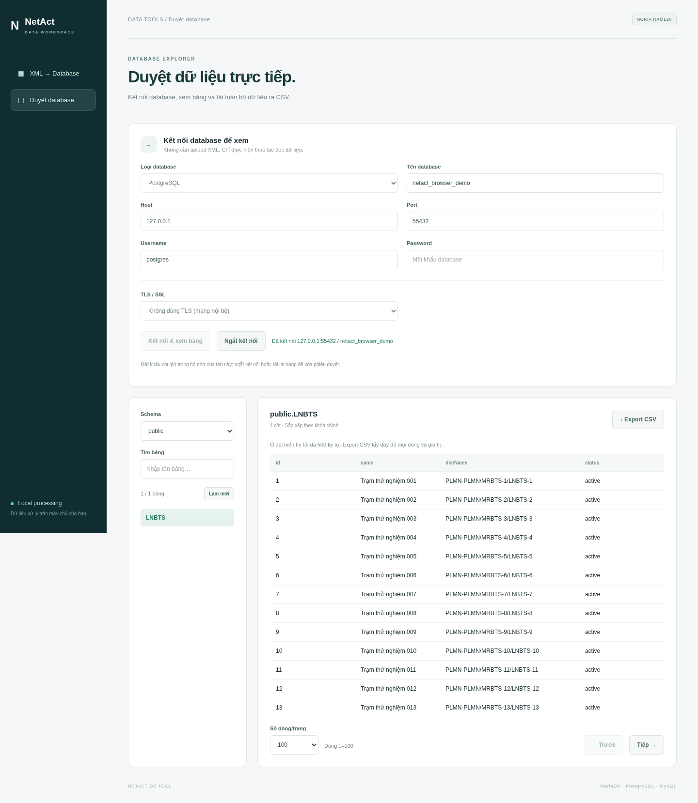

# NetAct XML → Database

Ứng dụng web tiếng Việt gộp hai bước **Nokia RAML20 XML → CSV → database**.
Dùng nguyên file `boda-nokiacmdataparser.jar` do người dùng cung cấp; phần nhập database
được viết lại từ quy trình trong script Python tham khảo. Không sao chép tài khoản hoặc mật khẩu cũ.

## Chạy bằng Python (không cần Docker)

Backend dùng **Python + FastAPI**, giao diện dùng HTML/CSS/JavaScript thuần, không dùng Bootstrap.
Yêu cầu Python 3.11+ và Java 11+ (`java -version`). Đã kiểm thử Python 3.12 và Java 21.
Cài Python, Java và Git trước khi chạy; Java phải nằm trong PATH.

### Windows PowerShell

```powershell
git clone https://github.com/phamhviet/netact-db-tool.git
cd netact-db-tool
py -m venv .venv
.\.venv\Scripts\python.exe -m pip install -r requirements.txt
.\.venv\Scripts\python.exe -m uvicorn app.main:app --host 127.0.0.1 --port 8000 --workers 1
```

Không cần kích hoạt virtualenv hay đổi ExecutionPolicy khi dùng trực tiếp `python.exe` như trên.

### Linux / macOS

```bash
git clone https://github.com/phamhviet/netact-db-tool.git
cd netact-db-tool
python3 -m venv .venv
.venv/bin/python -m pip install -r requirements.txt
.venv/bin/python -m uvicorn app.main:app --host 127.0.0.1 --port 8000 --workers 1
```

Nếu đã tải ZIP từ GitHub, giải nén và mở terminal trong thư mục dự án rồi chạy từ bước tạo `.venv`.
Trên GitHub có thể tải bằng **Code → Download ZIP**. Không cần tải ZIP đính kèm trong chat.
Để tái lập đúng toàn bộ phiên bản đã kiểm thử (gồm công cụ test), dùng
`-m pip install -r requirements.lock` thay cho `requirements.txt`.
Dừng máy chủ bằng **Ctrl+C** sau khi tác vụ nhập dữ liệu hoàn tất.

Mở trình duyệt tại `http://localhost:8000`. Chọn XML từ máy tính, nhập loại DB,
host, port, database, username, password và TLS. Nhấn **Kiểm tra kết nối**, sau đó
**Chuyển đổi & nhập**. Xem tiến độ và số bảng/dòng đã lưu.

- **Database đã có:** bỏ chọn “Tạo database mới”; tài khoản cần quyền CONNECT, CREATE TABLE, INSERT và DROP (để dọn khi lỗi).
- **Database mới:** chọn “Tạo database mới”; cần quyền CREATE DATABASE. PostgreSQL dùng database `postgres` để kết nối quản trị;
  MariaDB/MySQL dùng `information_schema`. Database đã tồn tại sẽ làm bước tạo thất bại.
- Tên database: chữ Latin, số, `_`, tối đa 63 ký tự, không bắt đầu bằng số.
- Host là địa chỉ **máy chủ web** truy cập được; không phải địa chỉ tương đối với máy đang mở trình duyệt.
- PostgreSQL mặc định 5432; MariaDB/MySQL 3306. Có thể sửa port.
- `verify-full` xác minh TLS bằng CA tin cậy của máy chủ. Chứng chỉ riêng cần cài CA trên máy chủ;
  không tắt xác minh để khắc phục lỗi chứng chỉ. PostgreSQL còn có `require` (mã hóa, không xác minh danh tính máy chủ).

## Chạy bằng Docker

```bash
docker compose up --build -d
```

Mở `http://localhost:8000`. Nếu database chạy trên cùng máy Docker, nhập host
`host.docker.internal`, không dùng `localhost`. Compose chỉ mở cổng trên loopback của máy chủ.
Dừng bằng `docker compose down`.

## Duyệt database và export CSV trên web

1. Chọn **Duyệt database** ở thanh bên (trên điện thoại cũng có nút chuyển mục).
2. Nhập loại database, host, port, tên database, username, password và TLS.
   Nhấn **Kết nối & xem bảng**. Không cần XML; database phải tồn tại sẵn.
3. Chọn schema, tìm tên bảng và nhấn bảng để xem dữ liệu. Nút **Làm mới** tải lại danh sách bảng.
4. Chọn 50/100/500/1.000 dòng mỗi trang, dùng **Trước/Tiếp** để xem tiếp.
5. Nhấn **Export CSV** để tải **toàn bộ bảng đang chọn**, không chỉ trang đang xem.
6. Nhấn **Ngắt kết nối** để xóa phiên duyệt; muốn đổi thông tin kết nối, ngắt rồi nhập lại.

- Chức năng duyệt chỉ đọc, tài khoản DB cần quyền xem schema/bảng và SELECT.
  Không có chức năng chạy SQL tùy ý, sửa hoặc xóa dữ liệu.
- Tên bảng/schema được kiểm tra với metadata DB; tên có khoảng trắng hoặc dấu ngoặc kép vẫn được xử lý.
- Mật khẩu được giữ trong bộ nhớ của tab, gửi trong body POST để đọc dữ liệu,
  không lưu vào localStorage/sessionStorage, URL hay cấu hình máy chủ. Tải lại trang sẽ phải kết nối lại.
  Máy chủ mở và đóng kết nối cho từng yêu cầu, không lưu phiên chứa mật khẩu.
- Nếu bảng có khóa chính, trang dữ liệu được sắp xếp theo khóa chính. Bảng không có khóa chính
  không đảm bảo thứ tự cố định; thay đổi dữ liệu đồng thời có thể khiến dòng lặp/thiếu giữa các trang.
  Không chạy COUNT toàn bảng khi mở trang để tránh truy vấn nặng trên bảng lớn.
- Ô dài chỉ hiển thị 500 ký tự trên web; export giữ giá trị đầy đủ.
  CSV là UTF-8 BOM, có header và quoting dấu phẩy/ngoặc kép/xuống dòng.
  SQL NULL thành ô rỗng trong CSV; dữ liệu binary thành chuỗi `base64:...`.
- Export dùng cursor theo lô 1.000 dòng và browser tải trực tiếp, không gom toàn bộ bảng vào RAM.
  Không đặt giới hạn số dòng export. Phiên duyệt và export là độc lập;
  ngắt kết nối trên web không hủy download đã bắt đầu. Nếu mất kết nối DB/mạng giữa chừng,
  file CSV có thể bị thiếu; cần tải lại. Nếu bị từ chối trước khi tải, lỗi hiển thị ở tab mới.
- Dùng HTTPS khi truy cập qua mạng; phạm vi một người dùng/mạng tin cậy như phần triển khai bên dưới.



## Chẩn đoán tác vụ thất bại

Thông báo lỗi nhập dữ liệu cho biết giai đoạn **Chuyển XML sang CSV**, **Kết nối/tạo database**
hoặc **Tạo bảng/nhập CSV**, kèm loại exception và mã lỗi DB nếu driver cung cấp.
Ví dụ MariaDB `1045` là lỗi xác thực, `1007` là database đã tồn tại, `1406` là giá trị vượt kiểu cột;
PostgreSQL `42501` là thiếu quyền. Gửi nguyên thông báo mới nếu cần hỗ trợ, không cần gửi cả XML.
Log máy chủ chỉ ghi mã tác vụ, giai đoạn, loại exception và mã lỗi, không ghi mật khẩu/câu SQL/dữ liệu XML.

## Hành vi nhập và xử lý lỗi

- Hỗ trợ MariaDB, PostgreSQL, MySQL qua SQLAlchemy. **MariaDB 11.4 và PostgreSQL 17 đã có kiểm thử tích hợp**;
  MySQL dùng cùng driver PyMySQL nhưng chưa được kiểm thử với máy chủ MySQL riêng.
- Một CSV tạo một bảng; hàng đầu là tên cột. Toàn bộ giá trị dùng TEXT để giữ ID, số 0 đầu,
  tiếng Việt và các tham số dạng chuỗi. Không tự chuyển chuỗi `null` thành SQL NULL.
  MariaDB/MySQL TEXT có giới hạn 65.535 byte/giá trị; dữ liệu vượt giới hạn hoặc vượt số cột DB sẽ báo lỗi.
- Tên bảng/cột được giới hạn theo byte UTF-8 (PostgreSQL 63; MariaDB/MySQL 64) và thêm hậu tố
  khi trùng tên, kể cả khác nhau chữ hoa/thường. API kết quả trả ánh xạ tên cột gốc/đích.
- Không DROP DATABASE, không ghi đè bảng. Nếu bất kỳ bảng đích nào tồn tại, dừng trước khi tạo/nhập các bảng.
  Hãy dùng database riêng, không cho tác vụ khác đồng thời sửa cùng database trong lúc nhập.
- Nhập theo lô 500 dòng. Thiếu cột được điền chuỗi rỗng; thừa cột hoặc có NUL thì dừng, không cắt bỏ dữ liệu.
  Bảng mã thử UTF-8 BOM, CP1252, Latin-1 theo script tham khảo; nhận diện encoding không thể bảo đảm mọi trường hợp.
- PostgreSQL rollback toàn bộ bảng/dữ liệu của lượt nhập khi lỗi. MariaDB/MySQL DDL tự commit,
  ứng dụng cố gắng xóa **chỉ các bảng do lượt nhập vừa tạo** khi có lỗi.
  Nếu mất kết nối hoặc máy chủ bị dừng đột ngột, có thể còn bảng/dữ liệu nhập dở; kiểm tra và dọn trước khi chạy lại.
  Database mới tạo được giữ lại kể cả khi nhập lỗi; không tự xóa database.
- Chỉ nhận một tác vụ tại một thời điểm; chạy **1 worker**, không dùng nhiều replica.
  Tiến độ phản ánh các giai đoạn và số bảng đã xử lý, không phải phần trăm byte chính xác.
- Không giới hạn dung lượng XML ở giao diện hoặc backend; không còn dùng `MAX_UPLOAD_MB`.
  File được sao chép theo khối 1 MB, không đọc toàn bộ file upload vào RAM.
  Multipart có thể spool xuống ổ đĩa trước đó: cần đủ ổ đĩa tạm cho multipart, XML gốc, XML chuẩn hóa và CSV.
  Nếu dùng Nginx, đặt `client_max_body_size 0;` và tăng timeout proxy phù hợp cho upload dài;
  các proxy/gateway khác có thể có giới hạn riêng cần cấu hình ở đó.
- Không đặt timeout chuyển đổi JAR hoặc ép heap ở 1 GB. JVM chọn heap theo RAM khả dụng.
  Với dữ liệu lớn, có thể cấp heap bằng `JAVA_TOOL_OPTIONS`, ví dụ `-Xmx8g` trên máy đủ RAM
  (PowerShell: `$env:JAVA_TOOL_OPTIONS="-Xmx8g"`; Linux: `export JAVA_TOOL_OPTIONS="-Xmx8g"`).
  Không giới hạn dung lượng upload không đồng nghĩa RAM/ổ đĩa vô hạn; khả năng xử lý vẫn phụ thuộc
  tài nguyên máy chủ và parser JAR. Chưa benchmark bằng XML thực tế dung lượng nhiều GB.
  XML phải đúng Nokia RAML20. Hỗ trợ khai báo DOCTYPE không chứa entity: ứng dụng chuẩn hóa XML theo luồng
  sang UTF-8 và loại DOCTYPE trước khi gọi JAR, không tải DTD ngoài. File upload gốc không bị sửa.
  Khai báo entity bị từ chối; cần xuất XML với giá trị trực tiếp. Lỗi cú pháp được báo theo dòng/cột của file gốc.
  Đây không phải bộ chuyển đổi cho mọi cấu trúc XML. File tạm có tên `input.xml`, nên cột FILENAME của CSV mang tên đó.
- XML, CSV và log JAR tạm bị xóa sau tác vụ; không lưu mật khẩu vào cấu hình, log hoặc kết quả.
  Mật khẩu dùng trong bộ nhớ của tiến trình để kết nối và được xóa khỏi form sau khi nhận tác vụ.
  Metadata kết quả giữ tối đa 100 tác vụ/24 giờ trong bộ nhớ, mất khi khởi động lại.
  Session trình duyệt chỉ lưu mã tác vụ để tiếp tục theo dõi khi tải lại trang.

## Phạm vi triển khai

Phiên bản này dành cho **một người dùng trên máy cá nhân/mạng nội bộ tin cậy**, chưa có đăng nhập.
Mặc định bind loopback. Nếu mở cho nhiều người hoặc Internet, cần reverse proxy HTTPS, xác thực,
phân quyền, giới hạn upload, giới hạn tài nguyên và danh sách host database được phép trước khi triển khai.
API kết nối database sử dụng địa chỉ do người dùng nhập, nên chỉ cho người tin cậy truy cập.
Không gửi mật khẩu qua HTTP trên mạng công cộng. API chặn POST khác Origin; không thay thế xác thực.
Không dùng `--reload` khi có tác vụ đang chạy: khởi động lại sẽ mất trạng thái.

## Kiểm thử

```bash
pip install -r requirements-dev.txt
python -m pytest -q
```

Mặc định hai kiểm thử database được skip. Để chạy tích hợp trên **database kiểm thử riêng**, không dùng DB sản xuất:

```bash
docker run -d --name netact-test-pg -e POSTGRES_PASSWORD=local-test-only -p 127.0.0.1:55432:5432 postgres:17
docker run -d --name netact-test-maria -e MARIADB_ROOT_PASSWORD=local-test-only -p 127.0.0.1:53306:3306 mariadb:11.4
# Chờ hai DB khởi động và nhận kết nối rồi chạy:
NETACT_TEST_DATABASES=1 python -m pytest -q
docker rm -f netact-test-pg netact-test-maria
```

Kiểm thử chạy JAR thật, upload API, tạo DB tạm, đọc lại giá trị tiếng Việt/ID `001`,
kiểm tra từ chối bảng trùng và dọn bảng sau lỗi CSV. Kiểm thử database còn xác minh danh sách bảng,
phân trang, tên bảng có dấu ngoặc kép, NULL và export 1.205 dòng qua nhiều lô, giữ nguyên giá trị CSV. Chỉ DB tên ngẫu nhiên do test tạo mới bị xóa.
Chưa có XML thực tế của người dùng để xác nhận các class/list đặc thù hoặc hiệu năng file lớn.

## Thành phần bên thứ ba

`vendor/boda-nokiacmdataparser.jar` do người dùng cung cấp, CLI ghi tác giả Bodastage Solutions (2019).
Giữ nguyên binary; kiểm tra điều khoản phân phối của công cụ trước khi phát hành sản phẩm ra ngoài.
